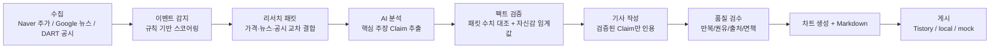

# MVP Blog

AI 기반 국내 주식 리서치 블로그 자동 발행 시스템 (Python 파이프라인 + Node 티스토리 발행 엔진).

`수집 -> 이벤트 감지 -> 리서치 패킷 -> AI 분석 -> 팩트 검증 -> 기사 작성 -> 품질 검수 -> 게시` 흐름으로,
주가/뉴스/공시의 **실제 데이터**만 사용한다. AI는 분석·작성·검수만 담당하며 수치나 사실을 창작하지 않는다
(패킷에 없는 숫자/사실은 팩트 체커가 거부).

## 아키텍처



- **이벤트 감지/스코어링/중복 제거는 전부 규칙 기반 Python** (`src/detectors`, `src/scoring`).
- **AI 사용처**: 리서치 분석(`src/analyzers/research_analyst.py`), 팩트 검증 보조(`fact_checker.py`),
  기사 작성(`writers/article_writer.py`), 품질 검수(`quality_checker.py`).
- 실데이터가 없는 환경에서도 동일 파이프라인을 검증할 수 있도록 **Mock 모드** 지원.

## 빠른 시작

```bash
# 1) venv + 의존성 (Python 3.11+)
py -3.14 -m venv .venv
.\.venv\Scripts\pip install -r requirements.txt

# 2) 환경 설정
copy .env.example .env   # 원하는 provider 키 입력

# 3) Mock 모드 전체 파이프라인 (키 없이 동작 검증)
$env:MOCK_MODE="true"
.\.venv\Scripts\python.exe main.py mock
```

## CLI

| 명령 | 동작 |
| --- | --- |
| `main.py mock` | Mock 데이터로 전체 파이프라인 실행 (collect~publish) |
| `main.py collect` | 주가/뉴스/공시 수집 |
| `main.py detect` | 이벤트 감지 (스코어 >= `minimum_research_score`) |
| `main.py research` | 리서치 패킷 + AI 분석 + 팩트 검증 |
| `main.py generate` | 차트 생성 + 기사 작성 + 품질 검수 → Markdown |
| `main.py publish` | 자동 선정된 기사만 게시 (Tistory / local / mock). `--retry-failed` 로 이전 실패 기사 재시도 |
| `main.py review` | `needs_review` / `quality_blocked` / `publish_failed` 기사와 미충족 사유 확인 |
| `main.py status` | 이벤트 상태 요약 |
| `main.py run` | collect ~ publish 일괄 실행 |

공통 옵션: `--config-dir DIR`, `--publish-backend NAME`, `--date YYYY-MM-DD`, `--limit N`, `--retry-failed`

## 환경 변수 (`.env`)

`ai` 섹션 참조:

- `AI_PROVIDER` / `OPENAI_API_KEY` / `ANTHROPIC_API_KEY` / `GOOGLE_API_KEY` — AI 분석·작성·검수
  (키가 없으면 `auto` → mock AI 사용)
- `STOCK_PROVIDER=naver` — 네이버 공개 차트 API(키 불필요)
- `NEWS_PROVIDER=google_rss` — Google 뉴스 RSS(키 불필요)
- `DART_API_KEY` — 금융감독원 전자공시(https://opendart.fss.or.kr) API 키
- `PUBLISH_BACKEND` — `tistory-node`(기본) | `tistory`(Python 폴백) | `local` | `mock`
- `TISTORY_BLOG_URL` — 티스토리 블로그 주소 (예: `https://myblog.tistory.com`)
- `TISTORY_STORAGE_STATE` — 로그인 세션(Storage State) Base64 값 (GitHub Secret. 로컬에서는 파일 사용)
- `TISTORY_VISIBILITY` — `private`(기본) | `protected` | `public`
- `ALLOW_PUBLIC=false` — 자동 공개 허용 스위치. `false` 이면 `TISTORY_VISIBILITY=public` 이어도 비공개로 발행
- `DAILY_PUBLISH_LIMIT=5` — 하루 최대 발행 건수 (KST 날짜 기준)
- `TISTORY_DRY_RUN=true` — 실제 발행 없이 에디터 진입·입력만 테스트
- `MOCK_MODE=true` — 외부 API 없이 전체 시뮬레이션

`config/settings.yaml` 에서 스코어 가중치, 임계값, 감지 룰, 티스토리 셀렉터를 조정한다.

## 티스토리 자동 발행 (Node + Playwright)

Tistory Open API는 종료되었으므로 **Playwright 브라우저 자동화 + 저장된 로그인 세션(Storage State)** 방식으로 발행한다.
콘텐츠 생성은 기존 Python 파이프라인(주식 데이터)이 그대로 담당하고, **발행만 Node 엔진**이 담당한다.

```text
Python: collect -> detect -> research -> generate (제목 + Markdown + 차트)
        |
        v
NodeTistoryPublisher (src/publishers/node_tistory_publisher.py)
        |  payload(JSON): 제목 / HTML / 태그 / 카테고리 / 공개설정 / 차트경로
        v
src/publishTistory.js (Playwright)
        -> 저장된 로그인 세션 -> 글쓰기 페이지 -> 제목/이미지/본문(TinyMCE API)/태그
        -> 비공개(private) 발행 -> 발행 URL 검증
```

- 발행 백엔드: `tistory-node` (기본) / `tistory` (기존 Python Playwright 발행기, 폴백)
- 본문은 DOM 클릭 대신 **TinyMCE JS API**(`tinymce.get('editor-tistory').setContent()` + `.save()`)로 주입해 UI 변경에 더 강하다
- 이미지 업로드도 Node 엔진이 처리한다 (`/charts/*.png` → 업로드 URL 치환)
- 첫 로그인은 사람이 직접 수행하고 세션만 저장/재사용한다 (ID/PW를 Secret에 저장하지 않는다)

### 1) 최초 로그인 세션 생성

```bash
# Node 엔진 (권장)
npm install
npx playwright install chromium
npm run login          # 세션 저장 (.state/tistory_storage_state.json)

# 기존 Python 스크립트도 동일한 세션 파일을 만든다
python scripts/tistory_login.py
python scripts/tistory_login.py --base64-out .state/tistory_storage_state.b64   # GitHub Secret용 Base64
```

브라우저가 열리면 직접 로그인(카카오 계정 + 2차 인증) 후 Enter. 생성된 세션 파일은 민감 정보이므로
**절대 커밋하지 않는다** (`.gitignore`에 `.state/`, `secrets/` 포함).

### 2) GitHub Secret 등록

| Secret | 용도 |
| --- | --- |
| `TISTORY_STORAGE_STATE` | 위 Base64 세션 값 |
| `TISTORY_BLOG_URL` | 블로그 주소 (예: `https://eneru.tistory.com`) |
| `TISTORY_VISIBILITY` | `private` (기본) / `public` |
| `TISTORY_DRY_RUN` | 디버깅 시 `true` |

GitHub Actions는 아래처럼 세션을 복원하고 (.state) 발행한다.

```bash
echo "$TISTORY_STORAGE_STATE" | base64 --decode > .state/tistory_storage_state.json
```

### 3) 발행 전략 (기본 비공개)

시스템 안정화 전까지는 `default_visibility: private` 으로 비공개 발행 후 URL/본문/이미지를 검증한다.
검증이 끝난 뒤에만 `public` 으로 자동 공개한다. 오류 시 스크린샷·HTML 스냅샷이
`artifacts/tistory-errors/` 에 저장되고 GitHub Actions Artifact로 업로드된다.

#### 하루 발행 기사 선정 (최대 5건)

`main.py publish` 는 모든 기사를 순서대로 올리지 않는다. `src/pipeline/publish_selector.py` 가
아래 조건을 모두 통과한 기사만 순위대로 고른다.

1. **발행 준비도** — 자체 계산 지표 4개 이상, URL 출처 1개 이상, 검색 의도 답변·시나리오·확인 조건 포함
2. **신선도** — 이벤트 발생 후 7일 이내, 최근 발행 기사와 유사도 0.55 미만
3. **품질** — 품질 점수 0.75 이상, 심각한 팩트체크 이슈 없음
4. **다양성** — 종목당 1건/일, 이벤트 유형당 2건/일
5. **한도** — `data/published/event_*.json` 의 `published_at` 을 KST 날짜로 집계해 5건까지만

조건을 통과하지 못한 기사는 `needs_review` 로 저장만 하고 발행하지 않는다.
`main.py review` 로 미충족 사유를 확인할 수 있다.

- 세션 만료(`TISTORY_SESSION_EXPIRED`): 자동 재로그인하지 않고 중단. `npm run login` 으로 새 세션 생성
- 재시도 정책: 일시적 네트워크/타임아웃만 최대 2회. 셀렉터 변경·세션 만료·이미지 실패는 재시도하지 않고 위젯/로깅으로 원인 파악

### 4) 에디터 UI 변경 대응 (SELECTORS 자동 수정)

티스토리 에디터 UI가 바뀌면 `src/publishTistory.js` 의 `SELECTORS` 가 깨진다.
`.github/workflows/selector-health.yml` 이 **매일 06:00 KST** 실제 에디터를 열어 검사한다.

```bash
npm run selectors:check   # 검사 (0=정상, 2=깨짐, 3=세션 만료)
npm run selectors:fix     # 깨진 선택자 추론 후 src/publishTistory.js 패치
```

- 깨진 선택자를 추론할 수 있으면 **PR을 자동 생성**한다 (`chore/tistory-selector-fix`).
- 추론 실패 또는 세션 만료면 **이슈를 생성**하고 `artifacts/selector-health/` 의
  `report.json` / `editor.html` / `editor.png` 를 아티팩트로 남긴다.
- 수동으로 맞출 때도 `SELECTORS` 객체만 고치면 된다.

## GitHub Actions 자동화

`/actions/google` 시크릿 설정 후 평일 09:00 KST 자동 실행 (`.github/workflows/scheduled.yml`):

| Secret | 용도 |
| --- | --- |
| `OPENAI_API_KEY` 또는 `ANTHROPIC_API_KEY` | AI 분석/작성/검수 |
| `DART_API_KEY` | DART 공시 |
| `TISTORY_STORAGE_STATE`, `TISTORY_BLOG_URL` | 티스토리 게시 (Playwright 세션) |
| `PUBLISH_BACKEND` | `tistory-node`(기본, Node 엔진) / `tistory`(Python 폴백) / `local` |
| `MOCK_MODE` | `auto`면 키 없을 때 자동 mock |

수동 발행: `.github/workflows/publish.yml` (`workflow_dispatch`, 기본 `private`).
부가 워크플로: `collect.yml`, `detect.yml`, `selector-health.yml` (에디터 SELECTORS 자동 점검/PR).

## 테스트

```bash
.\.venv\Scripts\python.exe -m pytest tests -q
```

## 디렉터리 구조

```
config/              # settings.yaml, event_rules.yaml, sources.yaml
src/
  collectors/        # Naver 주가 / Google 뉴스 / DART 공시 (+ mock)
  detectors/         # 규칙 기반 이벤트 감지
  scoring/           # 이벤트 스코어링·선정
  researchers/       # 리서치 패킷 결합
  analyzers/         # AI 분석, 팩트 검증, 품질 검수
  charts/            # 차트 선택·생성(외부 스크립트), TradingView 위젯
  writers/           # 기사 작성, Markdown, SEO
  renderers/         # Markdown -> Tistory 호환 HTML
  publishers/        # tistory-node(Node 브리지) / tistory(Python 폴백) / local / mock
  publishTistory.js  # Node Playwright 발행 엔진 (SELECTORS 단일 소스)
  publishCli.js      # Python -> Node 발행 브리지 CLI
  selectorHealth.js  # SELECTORS 검사 + 자동 추론/패치
  tistoryLogin.js    # Node 로그인 세션 생성
  tistoryConfig.js   # Node 발행 설정
  storage/ utils/    # 파일 저장소, 캐시, 로깅, 재시도
  pipeline/          # collect ~ publish 파이프라인 스텝
scripts/             # tistory_login.py (최초 로그인 세션 생성)
package.json         # Node 발행 엔진 의존성 (playwright, dotenv)
data/                # 수집 원본/이벤트/패킷/게시 마커 (gitignore)
content/stocks/*.md  # 생성 기사 (gitignore)
static/charts/*.png  # 생성 차트 (gitignore)
.state/              # 로그인 세션 (gitignore)
artifacts/           # 발행 오류/셀렉터 리포트 (gitignore)
tests/               # pytest (79 개)
```

## 면책

본 프로젝트가 생성하는 문서는 공개 데이터를 정리한 참고 자료이며, 투자 판단의 근거가 될 수 없다.
매수·매도 권유를 포함하지 않는다.